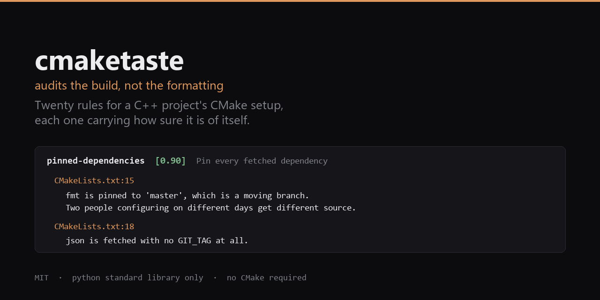

# cmaketaste

Audit a C++ project's build setup. Not its CMake formatting.

The linters that exist check style. `cmakelint` and `cmake-format` tell you about line
length, indentation and whether a command is upper or lower case, and both had their
last release in May 2024. Neither answers the questions that decide whether your build
is reproducible on another machine next year:

- Is that fetched dependency pinned, or riding whatever `master` happens to be today?
- Are include paths attached to targets, or leaking out of directory scope into every
  target below?
- Does anything, anywhere, run a sanitizer?
- Can another project consume this one with `find_package`, or only by vendoring it?

Twenty rules, each carrying its own confidence, because some of these are laws and some
are taste, and a tool that pretends otherwise gets switched off in a week.

Python standard library only. No install, no network, no CMake required.

## Use

```bash
python cmaketaste.py path/to/project
python cmaketaste.py . --min-confidence 0.85
python cmaketaste.py . --fail-at 0.9     # exit 1 on a finding this confident
python cmaketaste.py . --json
python cmaketaste.py --list-rules
```

Exit codes: `0` normally, `1` when `--fail-at` is given and a finding meets it, `2` on
bad arguments or a directory that holds no CMake at all.

## What it says

```
pinned-dependencies  [0.90]  Pin every fetched dependency
  CMakeLists.txt:15
    fmt is pinned to 'master', which is a moving branch. Two people configuring
    on different days get different source.

  CMakeLists.txt:18
    json is fetched with no GIT_TAG, so it follows the remote default branch.
    The build is not reproducible.

no-file-glob  [0.75]  List sources explicitly
  CMakeLists.txt:11
    file(GLOB ...) builds the source list at configure time. It does not even
    use CONFIGURE_DEPENDS, so adding a file does not reconfigure the build and
    the new file is simply not compiled.
```

Every finding that can point at a line does. Nothing is reported that is not written in
your files.

## The rules

| Confidence | Rule | What it looks at |
|---|---|---|
| 0.95 | `build-dir-ignored` | `build/` or `out/` in `.gitignore` |
| 0.90 | `cmake-minimum-version` | `cmake_minimum_required` at 3.24 or newer |
| 0.90 | `global-scope-commands` | `include_directories`, `add_definitions`, `link_libraries` and friends |
| 0.90 | `pinned-dependencies` | `GIT_TAG` on every `FetchContent_Declare`, and whether it moves |
| 0.90 | `export-compile-commands` | `CMAKE_EXPORT_COMPILE_COMMANDS`, in listfiles or presets |
| 0.85 | `presets-committed` | `CMakePresets.json`, with debug, release and a sanitizer preset |
| 0.85 | `cxx-standard-on-target` | `target_compile_features(... cxx_std_NN)` instead of raw `-std=` |
| 0.85 | `strict-warnings` | `-Wall -Wextra -Wpedantic` or `/W4` anywhere |
| 0.85 | `ctest-registered` | `enable_testing()` plus `add_test` or a `*_discover_tests` |
| 0.85 | `sanitizer-in-ci` | AddressSanitizer and UBSan in CI or in a preset |
| 0.85 | `clang-format-committed` | `.clang-format` in the repo, and a CI job that checks it |
| 0.80 | `no-global-cxx-flags` | `set(CMAKE_CXX_FLAGS ...)` in a listfile |
| 0.80 | `ninja-generator` | Ninja in the presets, ccache or sccache in CI |
| 0.80 | `dependency-discovery` | Everything through `FetchContent` and nothing through `find_package` |
| 0.80 | `namespaced-alias` | `add_library(foo::foo ALIAS foo)` |
| 0.80 | `portable-ci` | Linux, macOS and Windows in the CI matrix |
| 0.75 | `no-file-glob` | `file(GLOB)` for source lists, and whether `CONFIGURE_DEPENDS` is there |
| 0.75 | `install-and-export` | `install(TARGETS)` plus `install(EXPORT)` or a package config |
| 0.75 | `prefixed-options` | `option()` names prefixed with the project, tests defaulting off |
| 0.75 | `vendored-sources` | A `third_party/` with no README and no patch file |

Confidence is how sure the rule is of itself, not how bad the finding is. A 0.75 rule is
one reasonable people disagree about. Read it, and turn it off on purpose if you
disagree, with `--min-confidence`.

## The scanner

The rules need a tokenizer, so there is one: it handles line comments, bracket comments,
quoted arguments with escapes, bracket arguments, nested parentheses and commands
spanning lines. It is not a CMake interpreter and does not evaluate a single variable.
It reports what is written.

Measured against five real projects' root listfiles, fmt (673 lines), spdlog (460),
nlohmann/json (297), Catch2 (230) and googletest: 896 commands parsed, zero line numbers
outside the file, and in fmt every one of the 335 commands has its own name on the line
the scanner reported.

## Tests

```bash
python tests/test_cmaketaste.py
```

47 tests against two fixture projects. One breaks every rule on purpose, the other is
written correctly and must come back silent: a linter that complains about correct code
is a linter people stop running. Ten tests drive the command line and assert on exit
codes.

## What it will not do

Run CMake. Everything here is static reading, so it works on a machine with no compiler
and no CMake installed, and it cannot tell you anything that only appears at configure
time.

Evaluate variables. `cmake_minimum_required(VERSION ${MIN})` is reported as unreadable
rather than guessed at.

Decide for you. It prepares the argument; the choice is yours.

## The banner

`assets/banner.png` is drawn by `scripts/make_banner.py`, which needs Pillow. It is the
only thing in this repository that needs anything.

## License

MIT. See [LICENSE](LICENSE).
